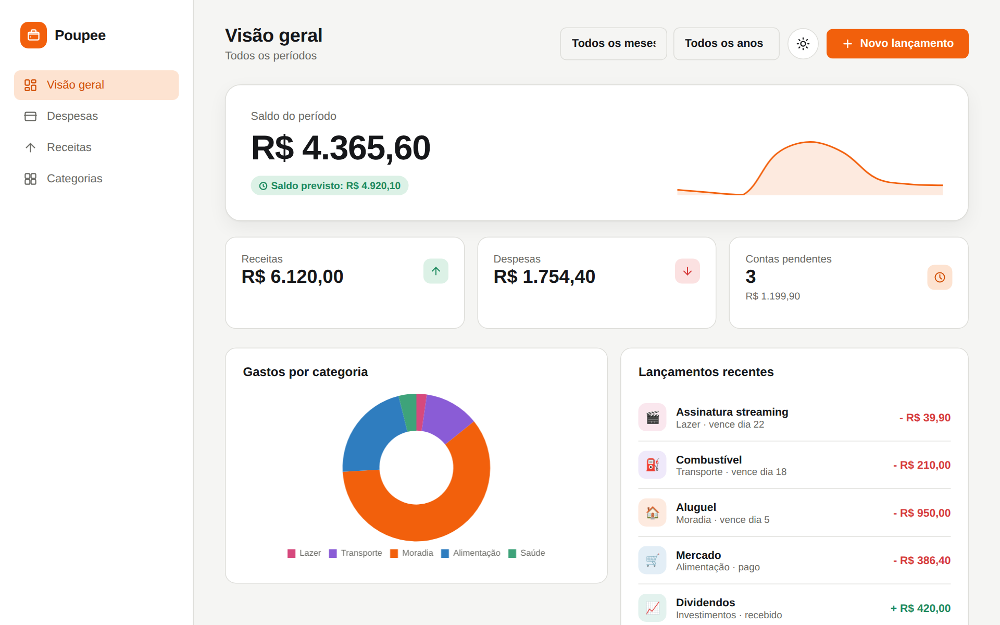
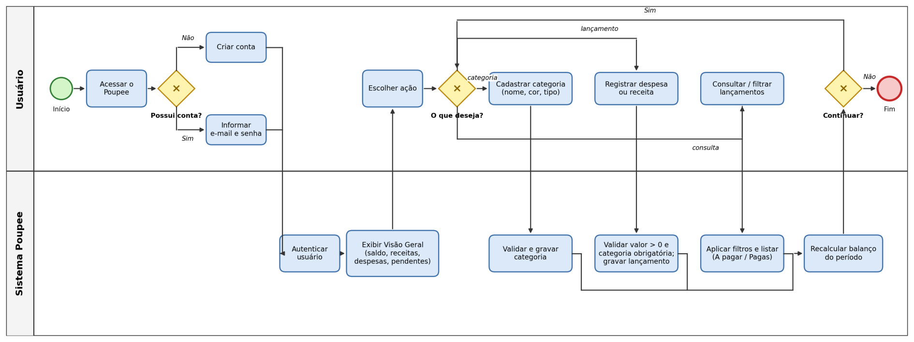
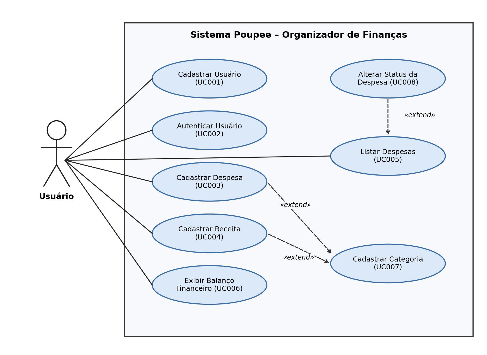
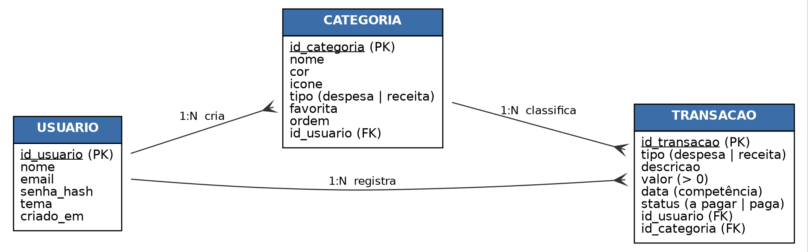
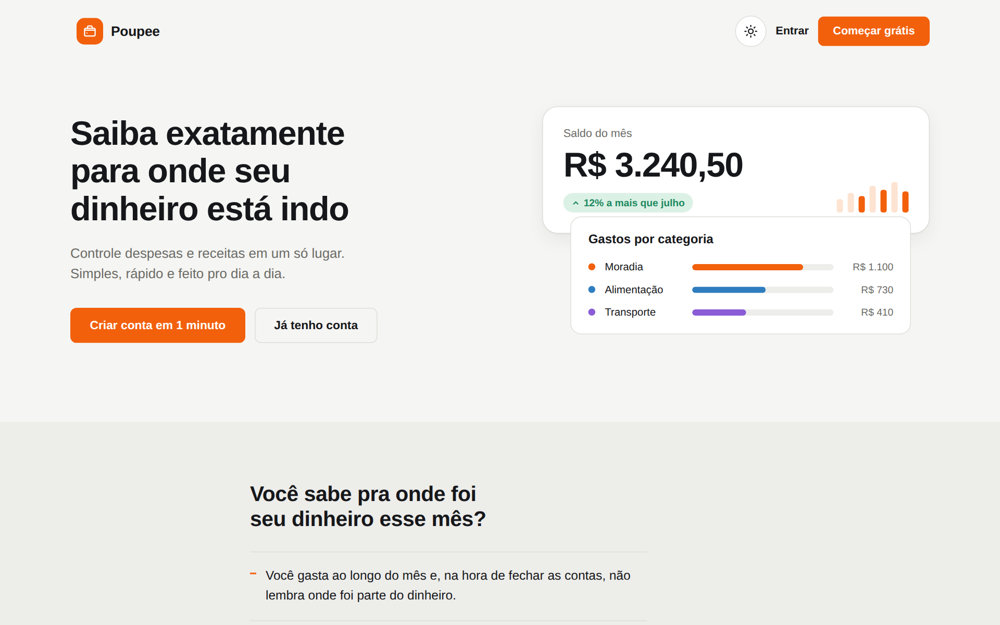
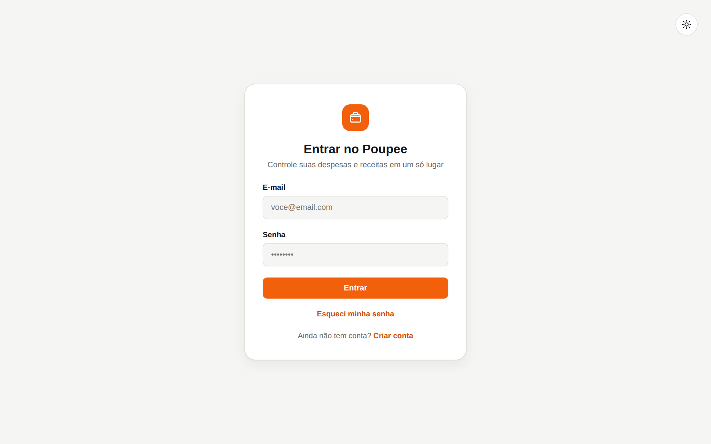
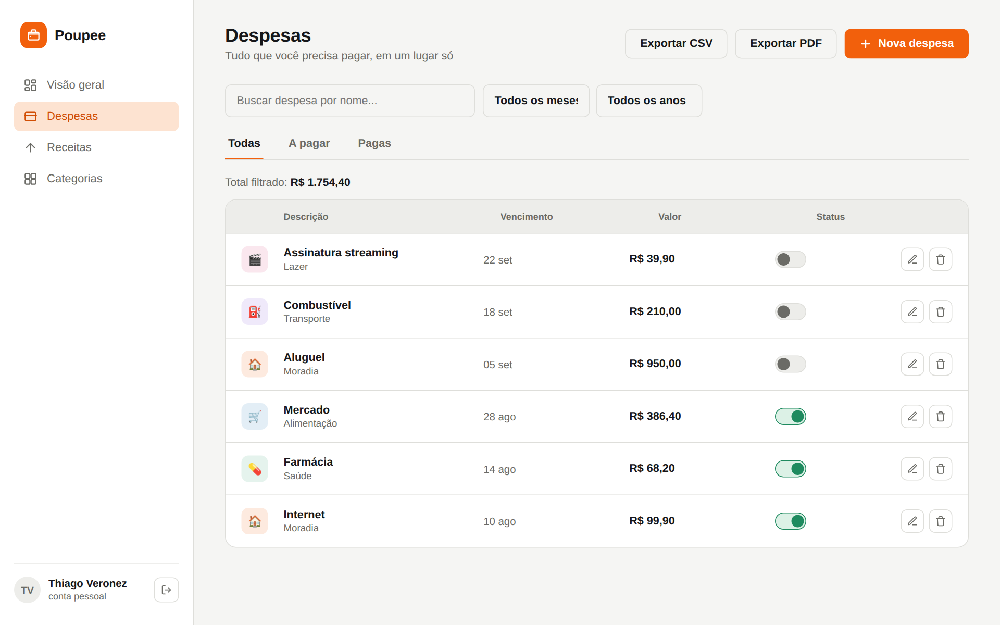
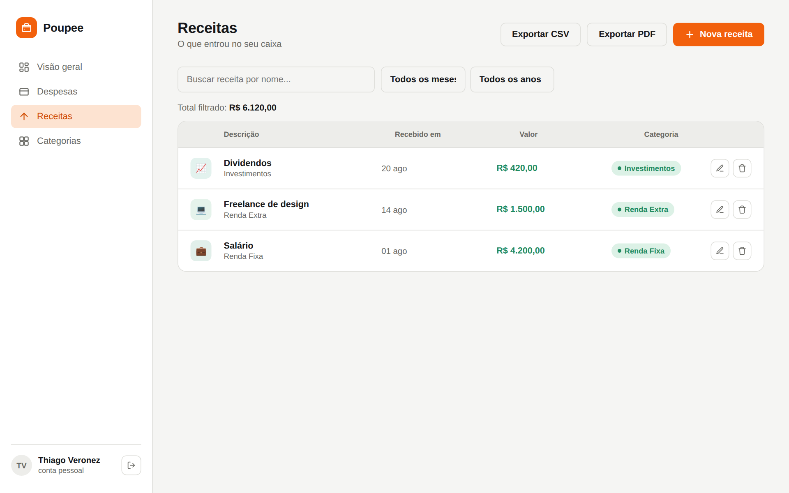
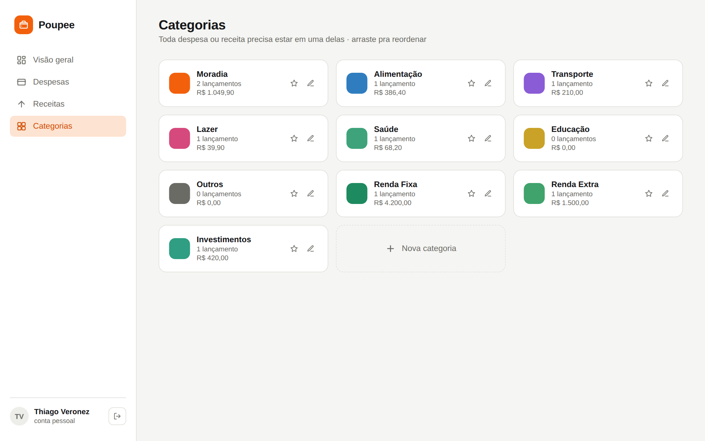
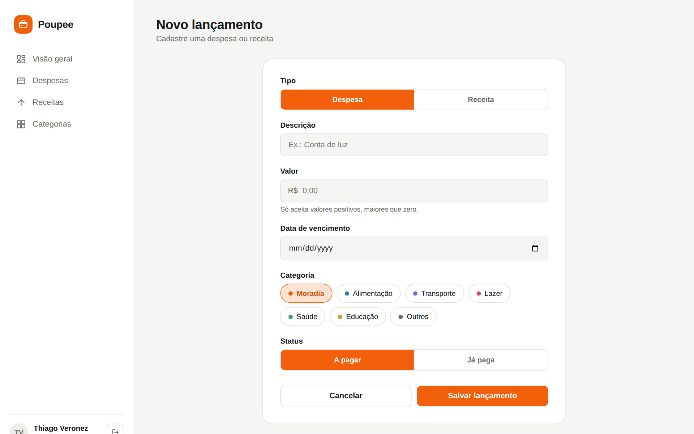

<h1 align="center">Poupee: organizador de finanças</h1>

<p align="center">
  Controle despesas e receitas em um só lugar e saiba exatamente para onde seu dinheiro está indo.
</p>

<p align="center">
  <a href="https://wsdxryann.github.io/Projeto-fincancas/"><strong>Abrir o protótipo navegável</strong></a>
  ·
  <a href="docs/requisitos.md">Requisitos</a>
  ·
  <a href="backend/README.md">API</a>
  ·
  <a href="docs/decisoes.md">Decisões</a>
</p>



## Sobre o projeto

Boa parte das pessoas não sabe, no fim do mês, para onde foi parte da renda: os gastos se acumulam,
contas vencem sem ninguém perceber e a planilha acaba abandonada por falta de praticidade.

O **Poupee** é um organizador de finanças pessoais para a web. O usuário cria a conta, registra
despesas e receitas em categorias, acompanha o que ainda está a pagar e vê, em um único painel,
o saldo do período e a distribuição dos gastos por categoria.

Projeto Integrador do curso de **Tecnologia em Desenvolvimento de Software Multiplataforma** da
**Fatec Franca "Dr. Thomaz Novelino"** (Centro Paula Souza), 2026.
<!-- Completar: disciplina, professor(a) orientador(a) e semestre -->

## Equipe

- Douglas Andrade Cintra de Brito
- Eleonora Cintra Castro
- João Pedro Racero Santos
- Ryan Filipe Damasceno
- Thiago Veronez da Silva Santos

| Frente | Responsabilidades |
| --- | --- |
| Layout e Visão Geral | Protótipo, padrão visual, componentes e tela de Visão Geral / Balanço |
| Tela de Despesas | Cadastro, formulários, filtros, listagem e responsividade |
| Lógica do sistema | CRUD, categorias, regras de negócio, validações, filtros, balanço e integração com o banco |
| Banco de dados | Modelos conceitual e lógico, tabelas, relacionamentos e persistência |
| Organização e documentação | GitHub, tarefas, requisitos, casos de uso, diagramas e revisão |

## Funcionalidades

- [x] Criar conta e entrar com e-mail e senha (senha guardada com hash)
- [x] Cadastrar, editar e excluir despesas e receitas
- [x] Categorias próprias com nome, cor e ícone, favoritas e ordem
- [x] Marcar despesa como paga ou a pagar com um clique
- [x] Filtros por mês, ano, status e descrição
- [x] Balanço do período: saldo, saldo previsto, contas pendentes e gastos por categoria
- [x] Exportar lançamentos em CSV e PDF (protótipo)
- [x] Tema claro e escuro
- [ ] Ligar as telas do protótipo à API (hoje o front ainda usa dados de exemplo)
- [ ] Recuperar senha por e-mail
- [ ] Conta bancária ([em discussão](docs/decisoes.md#5-conta-bancária-em-aberto))

Lista completa em [docs/requisitos.md](docs/requisitos.md).

## Tecnologias

| Camada | Tecnologia |
| --- | --- |
| Front-end | HTML, CSS e JavaScript, Chart.js, jsPDF, Driver.js (publicado no GitHub Pages) |
| Back-end | Node.js, Express, bcryptjs, JSON Web Token |
| Banco de dados | MySQL 8 (também funciona em MariaDB) |
| Testes | `node:test` (sem dependências extras) |

## Estrutura do repositório

```
.
├── index.html, script.js, styles.css   protótipo navegável (front-end)
├── backend/                            API REST (lógica do sistema)
│   ├── src/regras/                     validações, filtros e cálculo do balanço
│   ├── src/servicos/                   regras que consultam dados (conta, categorias, lançamentos)
│   ├── src/repositorios/               acesso ao MySQL (e versão em memória para testes)
│   └── test/                           testes automatizados
├── db/
│   ├── schema.sql                      tabelas, triggers e view do balanço
│   └── seed.sql                        dados de exemplo
├── docs/
│   ├── requisitos.md                   requisitos, regras de negócio e casos de uso
│   ├── decisoes.md                     registro de decisões do projeto
│   └── img/                            diagramas e telas
└── CONTRIBUTING.md                     guia de Git do time
```

## Como rodar

### Protótipo (só o front-end)

Abra o `index.html` no navegador, ou use a extensão Live Server do VS Code.
Também está publicado em <https://wsdxryann.github.io/Projeto-fincancas/>.

### Banco de dados

Com o MySQL instalado:

```bash
mysql -u root -p < db/schema.sql
mysql -u root -p < db/seed.sql     # opcional: dados de exemplo
```

### API

Precisa do Node.js 18 ou mais novo.

```bash
cd backend
npm install
cp .env.example .env               # ajuste usuário e senha do MySQL e o JWT_SEGREDO
npm start                          # API em http://localhost:3000/api
```

Sem MySQL instalado, dá para testar com dados em memória: `npm run dev:memoria`.

Login de exemplo (seed e modo memória): **thiago@exemplo.com** / **123456**.

Os endpoints, o formato das respostas e as regras estão em [backend/README.md](backend/README.md).

### Testes

```bash
cd backend
npm test
```

## Modelagem

| Processo (BPMN) | Casos de uso |
| --- | --- |
|  |  |

**Modelo entidade-relacionamento:** um usuário tem várias categorias e vários lançamentos; cada
lançamento pertence a uma categoria do mesmo tipo (despesa ou receita).



### Principais regras de negócio

- **Saldo do período** = receitas − despesas pagas; **saldo previsto** = receitas − todas as despesas.
- Valores sempre maiores que zero.
- Todo lançamento tem uma categoria, e ela precisa ser do mesmo tipo do lançamento.
- Só despesas têm status (a pagar / paga); receitas contam como recebidas.
- Um e-mail por conta; categoria com lançamentos não pode ser excluída.

## Telas

| | |
| --- | --- |
|  |  |
|  |  |
|  |  |

## Próximos passos

- Ligar as telas à API (login, lançamentos, categorias e balanço)
- Lembretes de contas a vencer
- Lançamentos recorrentes
- Metas de gastos por categoria

## Como contribuir

Veja o [guia de Git do time](CONTRIBUTING.md). Toda mudança entra por Pull Request, e os testes
rodam automaticamente no GitHub.

## Licença

[MIT](LICENSE)
